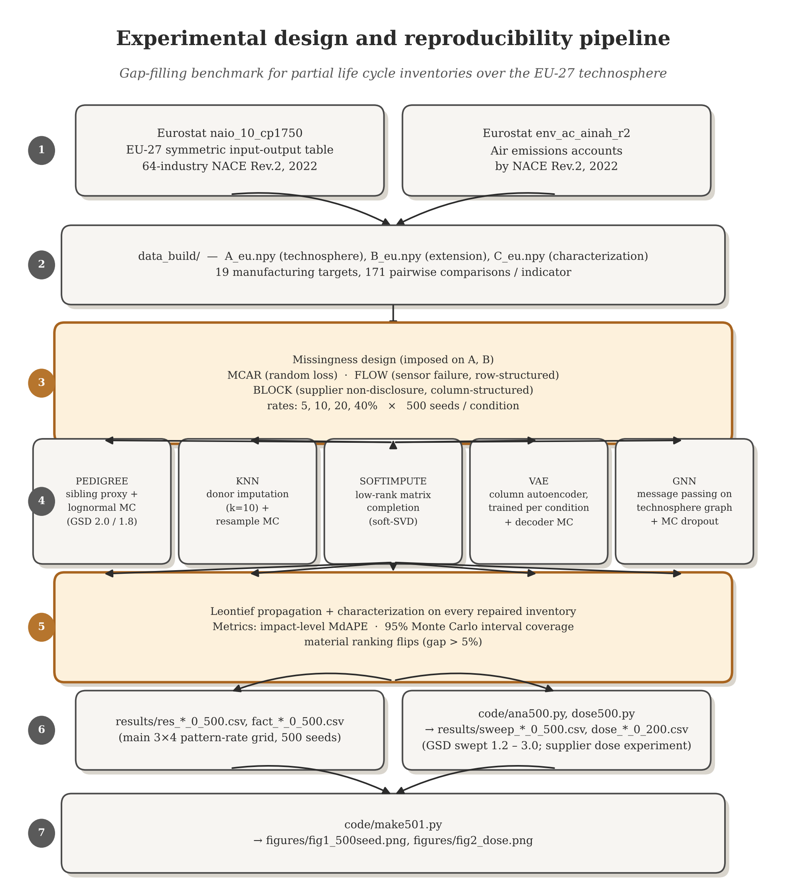

# Imputation or Acquisition? An EU-27 Input-Output Benchmark Locating the Boundary of Gap-Filling in Life Cycle Inventories

Companion repository for the manuscript submitted to the 34th CIRP Conference on
Life Cycle Engineering (CIRP LCE 2027):

> T. A. Khan, R. Kumar, V. Jayakumar, F. Cerdas, K. S. Sangwan, N. Khanna,
> "Imputation or Acquisition? An EU-27 Input-Output Benchmark Locating the
> Boundary of Gap-Filling in Life Cycle Inventories", Procedia CIRP, 34th CIRP LCE 2027.

All data are official EU statistics, retrieved from public Eurostat API endpoints.
No license, registration, or paid data access is required to reproduce any result
in this repository. (Working title above: "Decision cost of incomplete life cycle
inventories" — retained in `CHANGELOG.md` for provenance; the manuscript title is
the one above.)

**Results in this repository are the 500-seed results of the revised manuscript** (200 seeds
for the supplier dose experiment). The 3-seed files of the earlier release
(`results/results_final_eu*.csv`, `results/gsd_sensitivity_eu.csv`) and the figures made from
them (`figures/chart_*.png`, `fig_eu_full_benchmark.png`, `fig_gsd_sensitivity.png`) are kept
for provenance. The KNN donor search under supplier non-disclosure was corrected after that
release (`CHANGELOG.md`), so the earlier KNN values for that pattern no longer apply; the
ground truth and the other patterns are unchanged.

**Reproducibility status:** every number below was regenerated from the included
`data_build/` matrices, and reruns with the same seeds reproduce the stored results exactly
(see `CHANGELOG.md`). A rerun of the VAE and GNN with seeds 0 to 99 reproduces the first 100
seeds of the 500-seed files row for row.



**Fig. A1.** Experimental design and reproducibility pipeline: Eurostat data build,
the missingness design (pattern x rate x seed) applied identically to all five
repair methods, propagation through the Leontief inverse and characterization, and
the downstream metrics, GSD-sensitivity, and figure-generation stages. Boxes name
the exact script or artifact responsible for each stage; see
[Experiment design](#experiment-design) below for the full description.
Regenerate this figure with `figures/make_experiment_design_fig.py`.

## Data build

Two Eurostat datasets, both reference year 2022, geography EU27_2020:

- **naio_10_cp1750** — EU-27 symmetric input-output table, industry by industry,
  NACE Rev. 2 at 64-industry detail, current prices (million EUR).
- **env_ac_ainah_r2** — air emissions accounts by industry, NACE Rev. 2.

Technosphere matrix A is built as Z / x (intermediate use over industry output, row P1).
Environmental extension B is built as emissions over industry output. Characterization
matrix C uses Eurostat's own published aggregation groups: greenhouse gases (CO2
equivalents), acid gases (SO2 equivalents), tropospheric ozone precursors (NMVOC
equivalents), and primary PM2.5. One industry (U, extraterritorial organisations) has
zero output in the table and is excluded from the extension.

Build validation: summed mapped-industry GHG emissions reproduce the Eurostat-published
EU-27 total within 0.2%.

Retrieval endpoints (no key required):
```
https://ec.europa.eu/eurostat/api/dissemination/statistics/1.0/data/naio_10_cp1750?format=JSON&unit=MIO_EUR&stk_flow=TOTAL&geo=EU27_2020&time=2022
https://ec.europa.eu/eurostat/api/dissemination/statistics/1.0/data/env_ac_ainah_r2?format=JSON&geo=EU27_2020&time=2022&unit=THS_T
```

Built matrices (`A_eu.npy`, `B_eu.npy`, `C_eu.npy`, `meta_eu.json`) are included in
`data_build/` so the benchmark can be rerun without re-hitting the API. Data extracted
6 July 2026; cite both dataset codes and this extraction date in any Data Availability
statement, since Eurostat revises these tables periodically.

## Experiment design

Targets: 19 manufacturing industries (NACE C10-12 through C33), 171 pairwise comparisons
per indicator. Three missingness patterns are imposed on A and B: random loss (MCAR),
sensor failure (FLOW, structured by elementary flow), and supplier non-disclosure
(BLOCK, entire columns unknown). Rates: 5, 10, 20, 40% of the 64 industries (3, 6, 12 and
25 columns under BLOCK, drawn from the 45 non-manufacturing industries). 500 seeds per
condition, for all methods. A supplier dose experiment removes 1, 2, 3, 6, 12 or 25
non-manufacturing industries (200 seeds per condition).

Five repair methods are compared on identical masks:
- **PEDIGREE** — sibling-group (NACE section) proxy substitution with pedigree-style
  lognormal uncertainty widening (GSD 2.0 technosphere, 1.8 extension), current
  standard practice.
- **KNN** — donor-column imputation (k=10, distance-weighted) with donor-resampling
  Monte Carlo for uncertainty. For a fully masked
  column there is no jointly observed donor, so the donor set is the full sibling set with
  equal weights, which is the pedigree point estimate.
- **SOFTIMPUTE** — low-rank matrix completion via iterative soft-thresholded SVD.
- **VAE** — column-wise variational autoencoder, trained per condition on observed
  entries only, decoder-sample Monte Carlo for uncertainty.
- **GNN** — two-layer message-passing network over the technosphere adjacency
  (hand-implemented, no external graph library), MC-dropout for uncertainty.

A sixth method, **ROWMEAN** (mean of the observed entries in the same row, no
uncertainty estimate), serves as a naive reference.

Neural network outputs are clamped in log-space to the observed data range before
inverse transform, a standard stabilization step; see Limitations for what this does
and does not fix.

Metrics, all computed after propagation through impact assessment: impact-level median
absolute percentage error (MdAPE) per indicator, 95% Monte Carlo interval coverage,
and material pairwise ranking flips (true gap > 5%). Interval width
(median over the 19 targets and four indicators of the 95% interval width divided by the
true impact) is reported for the factorial comparison. MdAPE is summarized across seeds by
the median, coverage and flip rate by the mean.

## Headline findings (500 seeds; verified against results/ CSVs)

1. **Pedigree-widened uncertainty intervals never reach their nominal level.** Across
   the twelve pattern-rate conditions, coverage of nominal 95% intervals ranges from
   5.3% (random loss at the 40% rate) to 83.6% (sensor failure at the 5 and 10% rates),
   and falls below 30% in seven of the twelve conditions. At 5% random loss, where the
   median impact error is 2.8%, the intervals contain the true value in 29.2% of cases.

2. **Widening the pedigree factor does not close the gap.** A sweep of the GSD from 1.2
   to 3.0 across the full grid (60 pattern-rate-GSD combinations, same 500 seeds and 300
   draws as the main grid) reaches at most 87.2% (sensor failure, 5%, GSD 3.0); none
   reaches 95%. Under random loss at 40%, coverage is 3.1% at a GSD of 1.2 and 4.9% at
   3.0. A GSD of 2.0 reproduces the main grid exactly. See `results/sweep_*_0_500.csv`
   and panel (g) of `figures/fig1_500seed.png`.

3. **The failure comes from the uncertainty model, not from the proxy value.** A 2 x 2
   comparison crosses the point estimate (sibling mean or KNN) with the uncertainty
   model (independent lognormal factors or resampling from observed values). Under
   random loss at 5%, coverage is 29.2% (sibling, lognormal), 27.8% (KNN, lognormal),
   88.6% (sibling, resampling) and 92.3% (KNN, resampling). The independent factors
   partly cancel in the Leontief sum, and the sibling mean lies above the true value for
   skewed coefficients (the true value falls below the lower bound in 97% of the misses
   at 5% random loss). Resampling does not close the gap at high missingness (60.6% at
   40% random loss) and its intervals are wider (median width 134% of the true impact
   against 92% for the lognormal factors). See `results/fact_*_0_500.csv`.

4. **KNN is better calibrated than the pedigree baseline under entrywise missingness,
   through its resampled intervals and not its donor estimates.** Under random loss and
   sensor failure KNN reaches 57 to 92% coverage against 5 to 84% for pedigree, higher in
   all eight rate-pattern combinations. Point accuracy is comparable (median error 2.9
   and 2.8% at 5% random loss, 50.0 and 50.3% at 40%); KNN is lower under sensor failure
   at 40% (8.4 against 12.0%).

5. **Under supplier non-disclosure, error depends on how many industries are missing.**
   At the 40% rate (25 columns) the median error is 23.9% for the pedigree baseline and
   KNN (identical point estimates), 76.9% for the VAE, 41.1% for SoftImpute, 105.1% for
   the GNN and 18.6% for the row-mean reference; coverage is at most 66.7% for any method.
   In the dose experiment the sibling proxy has a median error of 0.4, 1.1, 1.8, 5.8, 12.3
   and 22.6% with 1, 2, 3, 6, 12 and 25 missing industries, with a wide spread across draws
   (interquartile range 0.5 to 6.4% at three and 6.8 to 23.7% at twelve). The rise is
   gradual, not a threshold. Whether acquiring supplier data would reduce the error was not
   tested, and non-disclosure is simulated as random. The BLOCK candidate pool excludes the
   19 target industries by construction.

6. **Model complexity does not track reliability.** Under sensor failure at the 40% rate
   the median error is 65.9% for the VAE, 47.4% for SoftImpute and 36.9% for the GNN,
   against 12.0% for pedigree and 8.4% for KNN; 38.6%, 33.6% and 26.6% of the VAE,
   SoftImpute and GNN seeds exceed 100% error (single-run maxima 2548, 3403 and 1239%).
   Under random loss at 40% the three give 20.7 to 23.0% against about 50% for pedigree and
   KNN, but their intervals are overconfident (VAE coverage never above 1.9%, GNN never
   above 3.4%, none for SoftImpute), and the row-mean reference reaches 24.3%. The VAE and
   GNN use fixed hyperparameters, so this describes them as configured.

7. **Decision stability is a different question from point error.** At the 40% rate under
   random loss the flip rate is 13.6% for pedigree, 15.2% for KNN, 10.8% for the VAE and
   GNN and 11.1% for the row-mean reference; under sensor failure KNN is lowest (2.9%) and
   the GNN highest (9.8%); under supplier non-disclosure pedigree and KNN give 3.1%.

## Fixed issues (see CHANGELOG.md for full detail)

A methodological audit of the earlier release of this repository and the companion
manuscript found two code-level issues and three manuscript-level issues, all
fixed:

- **Data leakage in PEDIGREE/KNN repair** — both functions averaged sibling/donor
  values from the true, unmasked matrices rather than excluding other currently-masked
  cells, which could inflate their accuracy and calibration under MCAR/FLOW. Fixed to
  mask-aware averaging; PEDIGREE and KNN numbers under MCAR/FLOW shifted by up to a few
  percentage points (BLOCK numbers were unaffected — see CHANGELOG.md for the
  condition-by-condition diff). SoftImpute, VAE, and GNN were already leakage-free and
  are numerically unchanged.
- **Latent FLOW mask-generation bug in `gsd_sensitivity.py`** — this script's
  `make_masks()` never had a real FLOW branch; it silently fell through to BLOCK-style
  column masking. Harmless while the sweep never included FLOW; caught the moment FLOW
  was added to the sweep (finding #2 below). Fixed to mirror
  `experiment_final_eu.py`'s FLOW branch exactly.
- **GSD sweep excluded FLOW entirely** (previously only MCAR/BLOCK at 20%/40%) —
  extended to the full 3-pattern x 4-rate grid.
- **Table 1's Coverage column mixed conditions its own caption didn't claim** — every
  column now reports the BLOCK@40% condition its caption states.
- **KNN silently degrading to PEDIGREE under BLOCK, and the Rubin-taxonomy framing of
  the missingness patterns, were undisclosed in the manuscript body** — both are now
  disclosed at the point they matter (see the manuscript's Section 4.4 and Limitations).

A later check found a fourth code-level issue, fixed in the 500-seed release:

- **KNN tie-break under supplier non-disclosure** — for a fully masked column all
  candidate distances tie, and the earlier code kept an arbitrary first ten of the tied
  candidates. KNN now uses the full sibling set with equal weights, so it equals the
  pedigree point estimate under this pattern. Random loss and sensor failure are
  unchanged.

Reruns after each fix reproduce the stored results exactly (see CHANGELOG.md).

## Figures manifest

`figures/fig1_500seed.png` — main figure of the revised manuscript, panels (a) to (h):
error (a to c) and coverage (d to f) under the three patterns, GSD sweep (g), ranking
flips at 40% (h).
`figures/fig2_dose.png` — supplier dose experiment (median error with interquartile
range, coverage, flips against the number of missing industries).

The figures below were made from the 3-seed release and are kept for provenance:

`figures/fig_eu_full_benchmark.png` — combined 2x3 grid, all patterns, error and
calibration.
`figures/fig_gsd_sensitivity.png` — GSD sweep, all conditions, combined.

Individual charts (one panel each, for manuscript figure selection):
- `chart_error_MCAR.png` / `chart_coverage_MCAR.png` — random loss, error and
  calibration.
- `chart_error_FLOW.png` / `chart_coverage_FLOW.png` — sensor failure, error and
  calibration.
- `chart_error_BLOCK.png` / `chart_coverage_BLOCK.png` — supplier non-disclosure,
  error and calibration.
- `chart_flips_pedigree.png` — material ranking flips under the pedigree baseline,
  all three patterns overlaid (decision-stability result, not in the combined figure).

The 500-seed figures are regenerated from `results/` by `code/make501.py`, and the
earlier figures by `code/make_figures.py`; none is a hand-edited artifact.

## Limitations

- 500 seeds per condition (200 for the dose experiment). A minority of seeds give extreme
  errors for the VAE, SoftImpute and GNN, so MdAPE is summarized by the median. Medians
  from the first 100 seeds differ from the 500-seed values by up to 16% (relative) at the
  40% rate for the VAE and GNN, so the figures for these two methods carry sampling
  uncertainty. Their hyperparameters are fixed.
- Whether acquiring supplier data would reduce the error was not tested, and supplier
  non-disclosure is simulated as random.
- This is an input-output testbed (64 industries), not a process-based inventory.
  The masking and evaluation logic transfer unchanged to process-based databases;
  that validation is future work.
- Log-space clamping bounds individual entry reconstructions to the observed range
  but does not prevent degradation once many imputed entries compound through the
  Leontief inverse; this is reported as a finding (finding 6), not resolved.
- KNN has no donor for a fully masked column and equals the pedigree point estimate
  under BLOCK (finding 5), so that comparison contrasts uncertainty treatments only; a
  hybrid estimator with a different fallback is a straightforward extension.
- The BLOCK candidate pool is restricted to the 45 non-manufacturing industries by
  construction, so finding 5 describes
  non-disclosure by an upstream supplier, not by one of the 19 target industries
  directly; whether it extends to target-industry non-disclosure is untested here.
- The GSD sensitivity sweep covers the full 3-pattern x 4-rate grid with the baseline
  method (earlier releases covered only MCAR/BLOCK at 20%/40% — see CHANGELOG.md).
- The PEDIGREE/KNN repair functions were leakage-free only after the fix listed under
  "Fixed issues"; SoftImpute, VAE, and GNN never had this issue.

## Reproducing

```
pip install -r requirements.txt
cd code
python experiment_final_eu.py MCAR
python experiment_final_eu.py FLOW
python experiment_final_eu.py BLOCK
python gsd_sensitivity.py
python make_figures.py
```

Scripts resolve the built matrices from `../data_build/` automatically, and write
result CSVs to `../results/` (falling back to the working directory if `results/`
doesn't exist). `make_figures.py` reads `results/` and (re)writes everything in
`figures/`. No GPU, no license, no registration. The commands above run the 3-seed
grid of the earlier release (under a minute on a single CPU core); the 500-seed runs are
listed in the last section and take about 13 minutes per pattern for the main grid
without the VAE, 14 minutes for the VAE and 31 minutes for the GSD sweep.

Environment used for the results in `results/`: Python 3.12, numpy 2.4.4,
pandas 3.0.2, torch 2.13.0 (CPU). Reproducibility does not depend on exact package
versions — the seed derivation is fixed and explicit (see `CHANGELOG.md`) and every
stochastic step uses `numpy.random.default_rng` or a fixed `torch.manual_seed`, not
Python's process-randomized `hash()`.


## 500-seed results (revised manuscript)

The revised manuscript reports 500 seeds per condition (the 3-seed files in `results/` from the earlier version are kept for provenance). Files added in this release:

| Result in the manuscript | Script | Output |
|---|---|---|
| Main grid, five methods (Table 1, Fig. 1a-f, h) | `code/run500.py <pattern> <methods> <seed0> <seed1>` | `results/res_<pattern>_*_0_500.csv` |
| Row-mean reference (Table 1, Fig. 1, Fig. S1) | `code/rowmean.py` | `results/res_ROWMEAN_0_500.csv`, `results/dose_ROWMEAN_0_200.csv` |
| Factorial comparison with interval width (Table 2) | `code/fact_width.py <pattern> <seed0> <seed1>` | `results/fact_*_0_500.csv` |
| GSD sweep (Fig. 1g) | `code/ana500.py <pattern> <seed0> <seed1>` | `results/sweep_*.csv` |
| Supplier dose experiment (Fig. S1) | `code/dose500.py` | `results/dose_*_0_200.csv` (200 seeds) |
| Interval factors around other point estimates (Table S5) | `code/center_test.py <pattern> <seed0> <seed1>`, `code/center_summary.py` | `results/center_*_0_500.csv`, `results/center_summary.json` |
| Monte Carlo draw check (Table S6) | `code/draws_check.py <seed0> <seed1>` | `results/draws_check_0_50.csv` |
| Mean error, median coverage, flip-rate intervals (Table S1) | `code/summary_extra.py` (run from the repository root) | `results/summary_extra.json` |
| Summary values, figures | `code/make501.py`, `code/numbers501.py` (run from the repository root) | `results/summary501.json`, `results/numbers.json`, `figures/fig1_500seed.png`, `figures/fig2_dose.png` |

Run the `code/` scripts from the `code/` folder; they read `experiment_final_eu.py` and `../data_build/`. `<pattern>` is `MCAR`, `FLOW` or `BLOCK`; `<methods>` is a comma-separated list such as `PEDIGREE,KNN,SOFTIMPUTE,GNN` or `VAE`. A single-seed run of `fact_width.py MCAR 0 1` reproduces the stored seed-0 rows exactly. Under `BLOCK`, KNN has no donor for a masked column and equals the pedigree point estimate (see `CHANGELOG`).

Declaration of AI use:
Declaration of Generative AI and AI-assisted technologies in the research process. During the preparation of this work, the author(s) used Claude (Anthropic) to run a simulated multi-reviewer critique of the manuscript draft prior to submission, to assist to a limited extent with code-management tasks, and to help condense the manuscript to the conference's six-page limit. All resulting suggestions and edits were evaluated by the author(s), who take full responsibility for the content of the publication.

## License

Code in this repository is released under the MIT License (see `LICENSE`). The
underlying Eurostat data (`data_build/*.npy`, `meta_eu.json`) are derived from
Eurostat's public dissemination API and are reusable under Eurostat's own terms,
which require acknowledgement of the source; see
https://ec.europa.eu/eurostat/about/policies/copyright.
